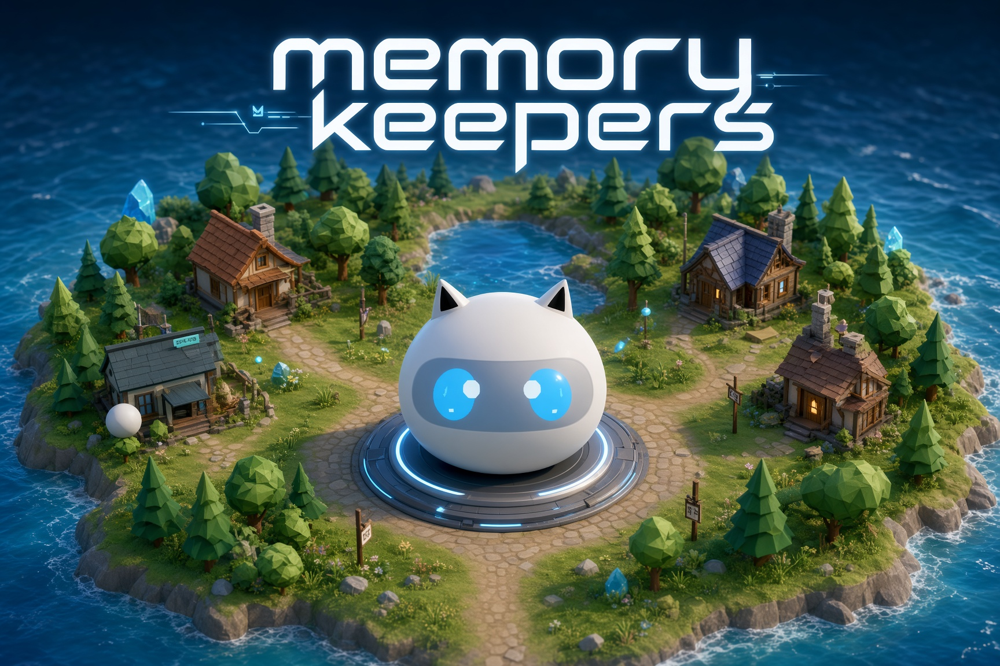
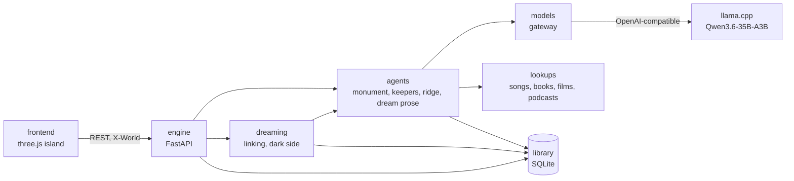

# memory-keepers



A 3D game where keepers (small blob librarians) guard your memories. Each keeper owns one layer of your life (dreams, meetings, music, anything you create), lives in a cottage on a floating island, and writes a library of books from what you tell her. Ask her and she answers only from her shelves, grounded in real books. At night the island dreams: everything that connects across shelves becomes a knowledge graph, and dark keepers are born from what keeps returning.

It runs entirely on your machine: Qwen on a llama.cpp server for the words, one SQLite file for the memories. Nothing you tell a keeper leaves the host.

## Why

Most AI interaction is a text box that waits. The question behind this project is how an AI can feel natural to live with, carry real meaning, and cover the whole spectrum of what you do instead of one narrow task. We are, in the end, a collection of memories and the events that happened to us, so the app points at life and memory itself.

Each layer of your life gets its own keeper: the music you hear, the movies you watch, the dreams that stay with you, your diet, your workouts, your meetings. Keepers capture who you are in those moments and hand back the details you lose ("that movie three weeks ago, the guy on an airplane?", "what was the urgent thing John asked me for?"). At night the island consolidates the day the way humans do, by dreaming: a knowledge graph connects the layers and surfaces what keeps returning, including what you avoid.

## Run

```
docker compose up
```

The game is at http://localhost:8000. Your worlds live in `./.data/memory-keepers.db` on the host, so they survive restarts and rebuilds; delete the file to start clean. One switch picks the brain, nothing else changes:

| MODEL_TIER | brain | needs |
|---|---|---|
| `fake` (default) | deterministic in-process model | nothing |
| `local` | Qwen3.6-35B-A3B on a llama.cpp server on the host | a machine that fits it |

Nothing installs on the machine; everything lives in the containers.

The local tier talks to any OpenAI-compatible server. With llama.cpp and a Qwen3.6 GGUF:

```
llama-server --model <path to Qwen3.6-35B-A3B .gguf> --alias qwen3.6-35b-a3b \
  --host 0.0.0.0 --port 8080 --jinja -ngl 99
MODEL_TIER=local docker compose up -d
```

The engine's health check probes the model server, and the game refuses to open while it is down, so a dead brain shows up at the door instead of as strange answers.

### Settings

| env | default | what |
|---|---|---|
| `MODEL_TIER` | `fake` in compose | `local` or `fake`; `MODEL_TIER_CHAT` / `MODEL_TIER_DREAM` override per role |
| `LOCAL_MODEL_URL` | `http://host.docker.internal:8080/v1` | the OpenAI-compatible endpoint |
| `LOCAL_MODEL_ID` | `qwen3.6-35b-a3b` | the model id the server answers to |
| `LOCAL_MODEL_KEY` | none | bearer key, when the server asks for one |
| `LIBRARY_DB` | `.data/memory-keepers.db` | the SQLite file |
| `DREAM_AT` | `03:00` | nightly dream for every world, local time; empty turns it off |
| `SESSION_TOKEN_BUDGET` | `32000` | tokens a keeper holds before she needs to sleep |
| `ACCESS_CODE` | none | island key: the API answers only callers who carry it (`/?key=` in the browser) |
| `OMDB_KEY` | none | richer movie facts; keyless Wikidata otherwise |

### Fill a world

To fill a world with sample memories and verify the whole loop (tells, grounded asks, a dream with its knowledge graph):

```
python3 scripts/demo_world.py http://localhost:8000 demo --verify
```

## Sample island

`samples/hector-island.json` is a whole island exported from this game: the author's own memories, told to five keepers through the real tell flow on the local tier (career, studies, repos, literature with two books told chapter by chapter, and Cronenberg films), loose remarks on every shelf, the ridge dreamed from what recurs across them, and the conversations behind every book. Load it with the HUD's Import island button (it lands on a fresh island id of its own, never on yours), then ask a keeper something, open a book, send her a remark, talk to the ridge, or run Dreaming.

To build an island from your own memories, write them as the seeder's JSON (keepers with `memories`, optional `remarks` sent through the router, and an `ask` to verify) and run:

```
python3 scripts/demo_world.py http://localhost:8000 mine --verify --memories my_memories.json
```

Export island then saves it back as one file.

## How a memory travels

```mermaid
flowchart LR
  you([you]) -->|say| route{route}
  route -->|tell| book[a book on her shelf]
  route -->|remark| notes[her notes book]
  route -->|ask| answer[answer from opened books]
  route -->|talk| chat[small talk]
  book --> sleep[sleep binds old turns into books]
  book --> dream[the island dreams]
  notes --> dream
  dream --> graph[knowledge graph]
  dream --> ridge[dark keepers on the ridge]
```

## Architecture

The project is a set of isolated boxes, each one folder with a `CONTRACT.md`; the contract alone is enough to use the box. Box map and dependency edges: [docs/INDEX.md](docs/INDEX.md).



| box | what |
|---|---|
| `frontend/` | three.js SPA, no build step |
| `engine/` | FastAPI surface, world scoping, meters, jobs, dream dispatch |
| `agents/` | monument root agent, keeper agents (tell, ask, talk, notes), ridge keepers, dream agents |
| `library/` | SQLite store: worlds, keepers, books, sessions, dream runs |
| `models/` | model gateway: local and fake tiers |
| `dreaming/` | consolidation: linking pass and dark side writer |
| `lookups/` | keeper tools: podcast transcripts, lyrics, song, book and movie facts |
| `samples/` | a whole island to import: the author's memories |

The decisions that shape it:

- **Keepers are tools of the monument, call and return.** The monument fans one question out across every shelf and synthesizes one answer; the root itself holds no corpus.
- **One switch picks the model.** The `models` gateway is the only place a provider exists: Qwen on an OpenAI-compatible server, or a deterministic fake for tests. Engine, agents, and dreaming never learn which tier runs.
- **The agent loop is plain code.** One small runtime sends chat-completions requests with the tools a flow offers, runs the calls, and returns the final text; no framework sits between the prompts and the model.
- **One SQLite file owns everything durable**: worlds, keepers, books, sessions, dream runs. Tests run the same code in memory.
- **Dreaming runs on the engine's loop.** The HUD asks for it, a tired keeper dispatches it, and a nightly timer sweeps every world. A deterministic linking pass builds the graph with zero model calls; the model only sorts human patterns from technical noise and writes the prose.
- **Runs are bounded and failure-tolerant.** One run is at most 12 model calls, stops on a repeated tool call, and every flow carries a deterministic fallback, so a bad model answer never breaks the game.

## Stack

- Qwen3.6-35B-A3B on llama.cpp (any OpenAI-compatible server works): keeper replies, synthesis, dream prose
- Python 3.13, FastAPI, httpx, SQLite (stdlib), uv workspace
- three.js frontend, no build step
- Docker Compose for dev, tests and serving

Keeper lookup tools: podcast transcripts, song facts (MusicBrainz) and lyrics (LRCLIB), book facts (Gutendex), movie facts and plots (OMDb, Wikidata, Wikipedia). `resolve_date` turns "tomorrow" or "in two weeks" into the calendar date before anything is written.

## Tests

```
docker compose run --rm test            # python boxes
docker compose run --rm test-frontend   # frontend
```

Real FastAPI app, real agent loop and tools, in-memory SQLite library, fake model tier; frontend on vitest + jsdom + Testing Library + MSW.

## Content and sources

Keepers read sources at capture time and store only what they write: a book holds facts, short quotes, and the user's relationship with the work, never a copy of it. Fetched text (a transcript, lyrics, a plot) lives only in the model's context while the book is written. Sources are chosen by license: MusicBrainz facts (CC0), Wikipedia plots (CC BY-SA, cited in the book), Project Gutenberg full texts only when a book is public domain, and podcast transcripts only when the publisher ships one in the feed.
